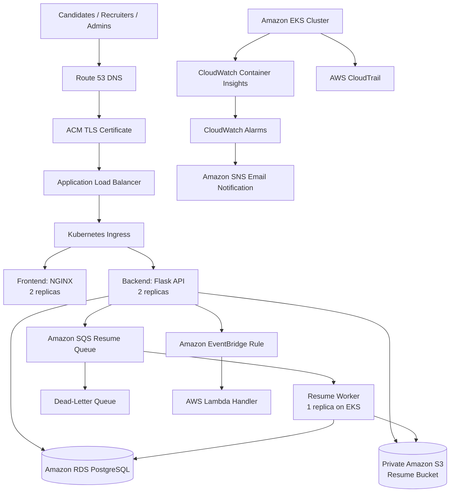

TalentFlow AI
An AI-powered recruitment and talent management platform deployed on AWS
using Amazon EKS. The project demonstrates containerized application
deployment, asynchronous resume processing, event-driven automation,
cloud security controls, and monitoring.
Project status: The application and the infrastructure components
listed below were implemented and validated to the extent described in
this README. This is an internship project, not a claim of formal
production certification.

Table of Contents
- Architecture
- Technology Stack
- AWS Resources
- Application Components
- Resume Processing Workflow
- Event-Driven Workflow
- Monitoring and Alerts
- Security
- Deployment Overview
- Validation Performed
- Operational Notes
- Limitations and Follow-up Work
Architecture

The diagram shows the logical application flow. It is not a subnet-level
network diagram and does not specify individual subnet IDs, Availability
Zones, or route tables.
Technology Stack
  Area                      Technologies
  Cloud platform            AWS
Container orchestration   Amazon EKS, Kubernetes
Containers                Docker
Frontend                  NGINX
Backend                   Python, Flask
Database                  Amazon RDS for PostgreSQL
Object storage            Amazon S3
Messaging                 Amazon SQS, Dead-Letter Queue
Event-driven processing   Amazon EventBridge, AWS Lambda
DNS and TLS               Amazon Route 53, AWS Certificate Manager
Load balancing            Application Load Balancer
Monitoring                Amazon CloudWatch, Container Insights
Notifications             Amazon SNS
Audit logging             AWS CloudTrail
Identity                  IAM Roles, EKS Pod Identity
AWS Resources
The deployed environment includes the following resources:
- Amazon EKS: Cluster talentflow-eks in us-east-1.
- Kubernetes namespace: talentflow.
- Deployments: talentflow-frontend, talentflow-api, and
  talentflow-resume-worker.
- Amazon RDS: Private PostgreSQL database.
- Amazon S3: Private resume bucket
  talentflow-resumes-488519936337.
- Amazon SQS: TalentFlow-Resume-Queue and
  TalentFlow-Resume-DLQ.
- Amazon EventBridge: TalentFlow-JobCreated-Rule.
- AWS Lambda: TalentFlow-JobCreated-Handler.
- Amazon CloudWatch: EKS Container Insights metrics and
  application/platform log groups, plus CPU and memory alarms.
- Amazon SNS: TalentFlow-CloudWatch-Alerts email topic.
- AWS CloudTrail: TalentFlow-Security-Trail.
- Amazon Route 53 / ACM / ALB: DNS, TLS certificate, and HTTPS
  application entry point.
The application URL used during validation was:

https://talentflow.unicornworlds.online
Application Components
Frontend
- Served by NGINX in Kubernetes.
- Deployed as talentflow-frontend.
- Configured with two replicas.
- The ingress/load-balancer path routes browser traffic to the
  frontend.
Backend API
- Python Flask application.
- Deployed as talentflow-api.
- Configured with two replicas.
- Connects to PostgreSQL and AWS services required by the application.
- NGINX forwards /api/ requests to the backend service.
Resume worker
- Deployed as talentflow-resume-worker.
- Configured with one replica.
- Runs python worker.py.
- Reads resume-processing messages from SQS, downloads the PDF from
  S3, extracts text, and updates the candidate record in PostgreSQL.
Resume Processing Workflow
1. A candidate uploads a PDF resume through the application.
2. The backend validates the object key and uploaded file, including
   the PDF signature and configured size limit.
3. The resume is stored in the private S3 bucket.
4. The backend records the resume key and sends a message to
   TalentFlow-Resume-Queue.
5. The worker receives the message and downloads the PDF from S3.
6. The worker extracts text from the PDF using pypdf.
7. The worker updates the candidate record with the extracted text and
   processing timestamp.
8. After successful processing, the worker deletes the message from
   SQS. Failed messages can be retried and eventually routed to the
   configured dead-letter queue according to the queue redrive policy.
The worker uses a dedicated IAM role through EKS Pod Identity. Its S3
read permission is scoped to the resumes/ object prefix, and its SQS
permissions are scoped to the resume queue.
Event-Driven Workflow
The project includes an EventBridge rule named
TalentFlow-JobCreated-Rule and a Lambda function named
TalentFlow-JobCreated-Handler.

A test job-created event was sent through the configured path, and the
test event was observed in the Lambda CloudWatch logs. This validates
the tested event path; it does not imply that every possible application
event or business scenario has been tested.
Monitoring and Alerts
Amazon CloudWatch and the EKS Observability add-on are used for cluster
and workload monitoring.

Configured log groups include:
- /aws/containerinsights/talentflow-eks/application
- /aws/containerinsights/talentflow-eks/dataplane
- /aws/containerinsights/talentflow-eks/host
- /aws/containerinsights/talentflow-eks/performance
- /aws/eks/talentflow-eks/cluster
- /aws/lambda/TalentFlow-JobCreated-Handler
Configured alarms:
- TalentFlow-EKS-High-CPU --- alarm threshold above 80% CPU
  utilization.
- TalentFlow-EKS-High-Memory --- alarm threshold at or above 80%
  memory utilization.
The alarms publish notifications through the
TalentFlow-CloudWatch-Alerts SNS topic. An alarm notification was
manually tested and an email was received.
Security
Security controls implemented or reviewed include:
- Private RDS database; inbound PostgreSQL access is restricted to the
  EKS cluster security group.
- Private S3 resume bucket with S3 Block Public Access enabled,
  bucket-owner-enforced object ownership, and SSE-S3 encryption.
- IAM roles and EKS Pod Identity for workload access to AWS services.
- Separate API and resume-worker IAM permissions.
- Resume-worker S3 access scoped to the resumes/ prefix.
- Resume-worker SQS access scoped to the resume queue.
- Kubernetes application configuration and credentials supplied
  through Kubernetes Secrets / Parameter Store integration.
- HTTPS application access using an ACM certificate and Application
  Load Balancer.
- CloudTrail multi-region management-event logging with log-file
  validation enabled.
- Management EC2 access through AWS Systems Manager; no inbound SSH
  rule was configured for that instance during the review.
Do not commit passwords, database connection strings, JWT secrets,
private keys, access keys, Kubernetes Secret values, or other
credentials to this repository.
Deployment Overview
The following is a high-level deployment outline. Exact image tags,
manifests, environment variables, and account-specific settings should
be checked in the repository and AWS environment before running
commands.
1. Clone the repository and review its README, Dockerfiles, Compose
   files, and Kubernetes manifests.
2. Build and test the frontend and backend containers.
3. Push the required container images to Amazon ECR.
4. Configure AWS access using an approved IAM role or AWS IAM Identity
   Center. Avoid hard-coding access keys.
5. Configure kubectl for the talentflow-eks cluster.
6. Ensure the talentflow namespace, workload IAM roles/Pod Identity
   associations, Kubernetes Secrets, and application configuration are
   present.
7. Apply or update the Kubernetes deployments, services, and ingress
   resources.
8. Verify rollout status, pod health, service endpoints, ingress, and
   application health endpoints.
9. Verify the resume queue/worker path and the CloudWatch logs and
   alarms.
Useful inspection commands:
# Confirm AWS identity and region
aws sts get-caller-identity
aws configure get region

# Configure kubectl for the cluster
aws eks update-kubeconfig --region us-east-1 --name talentflow-eks

# Inspect Kubernetes resources
kubectl get nodes
kubectl get all -n talentflow
kubectl get ingress -n talentflow

# Check deployments and pods
kubectl rollout status deployment/talentflow-api -n talentflow
kubectl rollout status deployment/talentflow-frontend -n talentflow
kubectl rollout status deployment/talentflow-resume-worker -n talentflow
kubectl get pods -n talentflow -o wide

# Inspect logs (replace POD_NAME with an actual pod name)
kubectl logs POD_NAME -n talentflow
These commands are for inspection and verification. Review the actual
manifest files and environment-specific values before applying changes.
Validation Performed
The following checks were recorded during project implementation:
- Application URL opened and login/dashboard pages were accessible.
- API readiness endpoint returned a ready response with database
  status ok.
- Resume upload and asynchronous processing were verified for a test
  candidate (candidate ID 28).
- The candidate record contained extracted resume text and a
  processing timestamp after the worker ran.
- The SQS queue had no visible or in-flight messages in a subsequent
  check.
- The EventBridge test event was observed in the Lambda CloudWatch
  logs.
- CloudWatch EKS metrics and logs were available.
- A CloudWatch alarm notification was manually tested and received by
  email.
- The RDS database was configured as private and the S3 resume bucket
  was configured as private.
These are specific validation results, not a claim that every feature,
failure scenario, security control, or production-readiness requirement
has been exhaustively tested.
Operational Notes
- The EC2 management instance is separate from the EKS application
  workloads. Stopping or terminating it does not automatically
  terminate the EKS cluster, RDS, S3, or other independent AWS
  resources. However, files stored only on that EC2 instance may be
  lost on termination.
- Before stopping or terminating any AWS resource, identify
  dependencies and check whether it is still needed for
  administration, deployment, or troubleshooting.
- AWS resources can continue to incur charges even when the management
  EC2 instance is stopped. EKS, load balancers, NAT gateways, RDS,
  storage, and other services may have separate costs.
- Check the AWS Billing console and resource inventory before leaving
  the environment running.
Limitations and Follow-up Work
Items identified for possible future improvement include:
- Review broad outbound network access and introduce Kubernetes
  NetworkPolicies where appropriate.
- Review IAM policies for least-privilege scope.
- Consider continuous ECR image scanning in addition to on-push
  scanning.
- Review whether CloudTrail data events are required for the project's
  audit needs.
- Reassess the seven-day retention configured for selected CloudWatch
  log groups.
- Review CloudTrail log-bucket encryption and any additional delivery
  integrations.
- Perform broader application, resilience, load, and security testing
  before any production use.
Repository
Source code: TalentFlow AI on
GitHub
Maintainer: Project internship team
Environment: AWS us-east-1
Project: TalentFlow AI
